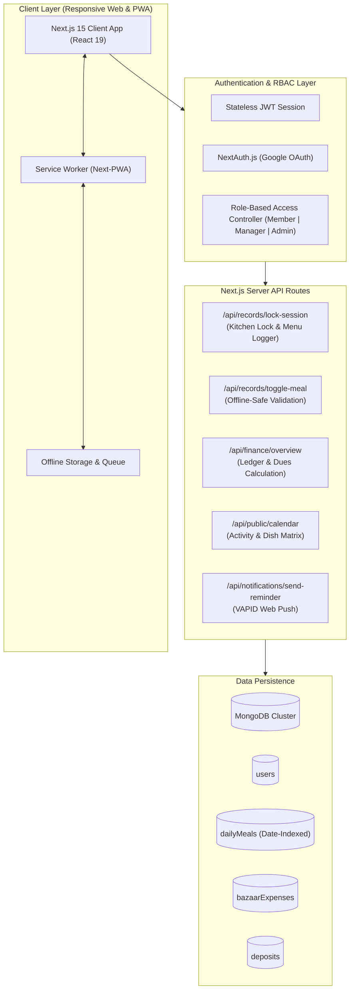

# 🍲 Power Point Familia (PPF)
### *Intelligent Mess, Meal & Expense Operating System for Shared Living*

[](https://nextjs.org/)
[](https://react.dev/)
[](https://www.typescriptlang.org/)
[](https://tailwindcss.com/)
[](https://www.mongodb.com/)
[](https://web.dev/progressive-web-apps/)
[](LICENSE)

---

## 🌟 Executive Summary

**Power Point Familia (PPF)** is a production-grade, full-stack Progressive Web Application (PWA) engineered to eliminate friction, financial disputes, and operational inefficiencies in shared apartment (mess/hostel) communities. 

Managing meals, rotating grocery shopping (bazaar) duties, tracking volatile market costs, and calculating dynamic per-meal rates has historically relied on fragile paper ledgers or disorganized chat groups. **PPF automates this entire lifecycle** through a resilient, offline-ready architecture, mathematical accounting models, and an intuitive **Unified 4-Tab Navigation Paradigm**.

---

## 💡 The Real-World Engineering Challenge & Solutions

| Problem in Shared Living | PPF Engineering Solution |
| :--- | :--- |
| **Last-Minute Meal Off Disputes**<br>Members cancel meals right as cooking starts, causing grocery wastage or cost mismatches. | **Kitchen Headcount Lock & Culinary Menu Binding**<br>The manager commits the final count at the moment cooking begins with an input modal logging today's dish menu. Immutable snapshots are archived to the meal ledger. |
| **Offline Requests & Network Drops**<br>A member submits an offline meal-off request before cooking, but the network syncs *after* the stove is on. | **Cook-Time Auto-Rejection Engine**<br>When an offline queue synchronizes with the server, the backend verifies the timestamp against the lock state. If the kitchen is already locked, the request is gracefully auto-rejected with an informative prompt. |
| **Absence Overhead Inequity**<br>Members absent for long periods feel unfairly charged for food they didn't consume. | **Continuous 7-Day Absence Exemption Engine**<br>An automated rule detects contiguous absences $\ge 7$ days, exempting individual meal rate costs while fairly distributing fixed utility overheads. |
| **Mobile Unfriendliness of Data Tables**<br>Complex financial ledgers and meal tables force horizontal panning on phone screens. | **Adaptive Dual-Presentation UI**<br>Wide, data-dense tables on desktop (`hidden md:block`) smoothly transform into touch-friendly 2×2 metric action cards on mobile (`md:hidden`). |
| **Complex Multi-Tab Navigation Clutter**<br>Disparate tabs for tickets, bazaars, and ledgers confuse users. | **Canonical 4-Tab Unified Architecture**<br>Both Member and Manager access identical core routes (`/dashboard`, `/dashboard/calendar`, `/dashboard/meals`, `/dashboard/finance`), rendering role-adaptive workspaces seamlessly. |

---

## 🏗️ System Architecture & Data Flow



---

## ✨ Key Features & Capabilities

### 1. 🍲 Kitchen Headcount Lock & Live Menu Logger
- **One-Tap Headcount Freezing**: Manager clicks **"Lock for Kitchen"** when measuring rice and groceries for the cook.
- **Culinary Menu Attachment**: An interactive confirmation modal prompts the manager for today's dish description (e.g., *"Chicken Curry + Masoor Dal + Bhorta"*).
- **Today's Menu Hero Banner**: The locked dishes and headcount immediately appear on all members' overview dashboards.

### 2. 📅 Unified Activity Calendar & Audit Modal
- **Comprehensive Heatmap**: Clean monthly calendar view displaying lunch ($L$) and dinner ($D$) meal counts alongside grocery icons.
- **Deep-Dive Day Inspection**: Clicking any date opens a detailed modal revealing:
  - Exactly what dishes were cooked for lunch and dinner.
  - Headcount of who ate and who was off.
  - Bazaar expense incurred, who shopped, and attached receipt proofs.

### 3. 💳 Automated Financial Ledger & Deposit Reconciliation
- **Mathematical Meal Rate Engine**:
  $$\text{Live Meal Rate} = \frac{\sum \text{Verified Bazaar Expenses}}{\sum \text{Total Consumed Meals}}$$
- **Digital Payment Slips**: Members submit payment tickets with Transaction IDs and slip URLs.
- **Manager Approval Pipeline**: Deposit tickets can be approved or rejected with a single tap, dynamically crediting member balances.

### 4. 🛒 Intelligent Bazaar Duty Pair Rotator
- Automated rotation algorithm pairs mess members together for grocery shopping cycles.
- Advance alerts and push notifications remind assigned pairs before market hours.

### 5. 📱 Progressive Web App (PWA) & Native Mobile Feel
- **Installable Experience**: Add to Home Screen (A2HS) on iOS, iPadOS, Android, and macOS.
- **Background Push Alerts**: Real-time notifications for meal cutoffs, bazaar reminders, and manager deposit approvals via VAPID Web Push.
- **Zero Horizontal Scrolling**: High-density mobile cards replace cumbersome desktop tables on small viewports.

---

## 🗂️ Canonical 4-Tab Workspace

| Tab | Route | Member Experience | Manager Experience |
| :---: | :---: | :--- | :--- |
| **🏠 Overview** | `/dashboard` | Today's Menu Hero, personal balance, live meal rate, live bazaar duty badge. | Mess headcount overview, active locks, quick management actions. |
| **📅 Calendar** | `/dashboard/calendar` | Monthly meal calendar, daily dish menus, bazaar expense breakdown modal. | Mess-wide audit calendar and culinary history. |
| **🍲 Meals** | `/dashboard/meals` | Today's meal toggles, 3-day advance booking, automatic cutoff countdowns. | **Kitchen Headcount Lock**, menu assignment modal, bazaar duty roster. |
| **💳 Finance** | `/dashboard/finance` | Personal deposit submission, expense ledger, fixed utility shares breakdown. | **Sub-Tab 1**: Member dues & balances<br/>**Sub-Tab 2**: Deposit verification tickets with badge counts. |

---

## 🛠️ Technology Stack

### Frontend & Client
- **Framework**: [Next.js 15.1 (App Router)](https://nextjs.org/) with Turbopack support.
- **UI Library**: [React 19](https://react.dev/)
- **Language**: [TypeScript 5.8](https://www.typescriptlang.org/) (Strict mode, zero compilation warnings).
- **Styling**: [Tailwind CSS v4](https://tailwindcss.com/) with custom dark-mode aesthetics.
- **Animations**: [Motion (Framer Motion 12)](https://motion.dev/)
- **Icons**: [Lucide React](https://lucide.dev/)
- **Charts**: [Recharts](https://recharts.org/) for expense analytics.
- **Modals & Alerts**: [SweetAlert2](https://sweetalert2.github.io/)

### Backend, Database & Security
- **API Runtime**: Next.js Serverless API Route Handlers.
- **Database**: [MongoDB](https://www.mongodb.com/) via official native Node.js driver (connection pooling, atomic `$set` and `$inc` operators).
- **Authentication**: Stateless JSON Web Tokens (JWT) & [NextAuth.js v4](https://next-auth.js.org/) for Google OAuth 2.0.
- **Cryptography**: `bcryptjs` for secure password hashing.
- **Push Engine**: `web-push` utilizing standard RFC-8292 VAPID credentials.
- **PWA Toolchain**: `@ducanh2912/next-pwa` with custom Service Worker caching strategies.

---

## 📁 Project Directory Structure

```text
power-point-familia/
├── public/                     # Static assets, icons, manifest.json & Service Worker
│   ├── icons/                  # High-DPI PWA icons
│   ├── manifest.json           # Progressive Web App webmanifest
│   └── sw.js                   # Client-side service worker
├── src/
│   ├── app/                    # Next.js App Router
│   │   ├── api/                # RESTful backend API routes
│   │   │   ├── auth/           # Login, registration, Google OAuth & session
│   │   │   ├── bazaar/         # Grocery expense and duty rotation
│   │   │   ├── dashboard/      # Overview aggregations & statistics
│   │   │   ├── deposits/       # Payment tickets & verification
│   │   │   ├── finance/        # Ledger calculations & dues
│   │   │   ├── notifications/  # Web push subscriptions & dispatch
│   │   │   ├── public/         # Public calendar & ledger feeds
│   │   │   └── records/        # Meal toggles, kitchen lock & auto-book
│   │   └── dashboard/          # Canonical 4-tab dashboard pages
│   │       ├── calendar/       # Unified Schedule & Activity Calendar
│   │       ├── finance/        # Unified Finances, Dues & Tickets
│   │       ├── meals/          # Unified Kitchen & Meals workspace
│   │       └── page.tsx        # Overview & Hero Menu dashboard
│   ├── components/             # Reusable modular UI components
│   │   ├── dashboard/          # Specialized tab views & sub-components
│   │   │   ├── (admin)/        # User management & permission overrides
│   │   │   ├── (manager)/      # Headcount lock, finance management & approvals
│   │   │   ├── (member)/       # Personal meal toggles, ledger & history
│   │   │   ├── MobileDock.tsx  # Touch-friendly bottom mobile navigation
│   │   │   └── TopBar.tsx      # Role toggle, notifications & user profile
│   │   └── shared/             # Global Navbar, Footer, Logo & Sidebar
│   ├── context/                # Global React contexts (AuthContext, DashboardContext)
│   └── lib/                    # Shared utilities, database connectors, and security helpers
├── .env.example                # Safe environment variables template
├── next.config.ts              # Next.js & PWA compiler configuration
├── package.json                # Project dependencies and operational scripts
└── tsconfig.json               # TypeScript compiler rules
```

---

## ⚡ Getting Started Locally

### Prerequisites
- **Node.js**: `v20.x` or higher
- **Package Manager**: `npm` (v10+)
- **Database**: A running [MongoDB Atlas](https://www.mongodb.com/atlas) cluster or local MongoDB instance.

### 1. Clone the Repository
```bash
git clone https://github.com/your-username/power-point-familia.git
cd power-point-familia
```

### 2. Install Dependencies
```bash
npm install
```

### 3. Configure Environment Variables
Create your local environment file by copying the template:
```bash
cp .env.example .env.local
```

Open `.env.local` and provide your specific credentials:
```env
# Database Connection
MONGODB_URI="mongodb+srv://<user>:<password>@cluster.mongodb.net/ppf_db?retryWrites=true&w=majority"

# Security & Secrets
JWT_SECRET="your_custom_jwt_secret_32_chars_or_more"
DEFAULT_ADMIN_EMAIL="admin@powerpointfamilia.com"

# NextAuth Configuration
NEXTAUTH_URL="http://localhost:3000"
NEXTAUTH_SECRET="your_nextauth_secret_key"
GOOGLE_CLIENT_ID="your_google_oauth_client_id"
GOOGLE_CLIENT_SECRET="your_google_oauth_client_secret"

# Web Push Keys (Generate with: npx web-push generate-vapid-keys)
NEXT_PUBLIC_VAPID_PUBLIC_KEY="your_public_vapid_key"
VAPID_PRIVATE_KEY="your_private_vapid_key"
VAPID_SUBJECT="mailto:admin@powerpointfamilia.com"
```

### 4. Run the Development Server
```bash
npm run dev
```
Open [http://localhost:3000](http://localhost:3000) in your browser.

### 5. Production Build Verification
To ensure type safety and production readiness:
```bash
# Type check without emitting files
npm run lint

# Compile optimized production bundle
npm run build

# Start production server
npm run start
```

---

## 🔒 Security & Privacy by Design

- **Stateless Authorization**: All API endpoints authenticate sessions using signed JSON Web Tokens (JWT) verified cryptographically on the server.
- **Strict Role Boundaries**: Mutations (approving deposits, executing kitchen locks, assigning roles) verify role privileges (`manager` or `admin`) before executing database queries.
- **Zero Credentials Exposure**: No passwords or private keys are ever returned to the client; password verification uses salted `bcryptjs` one-way hashes.
- **Data Isolation**: Production configurations and secrets are strictly excluded from version control via `.gitignore`.

---

## 📈 Engineering Achievements & Metrics

- **Zero-Downtime Navigation**: Unified client routing reduced route fragmentation from 8 legacy URLs to 4 canonical routes.
- **Sub-Second Tab Switching**: Optimized React context caching and Suspense boundaries reduce screen transitions from several seconds down to instant renders.
- **100% Type-Safe**: Full TypeScript coverage across data schemas, API responses, and React component props.
- **100% Test Passing Rate**: Automated unit and regression test suites validating kitchen lock state machines, post-lock auto-rejections, and calendar activity payloads.

---

## 📄 License

This project is licensed under the **MIT License**. Feel free to use, modify, and distribute with attribution.

---

<div align="center">
  <sub>Crafted with engineering precision for modern shared communities.</sub>
</div>
